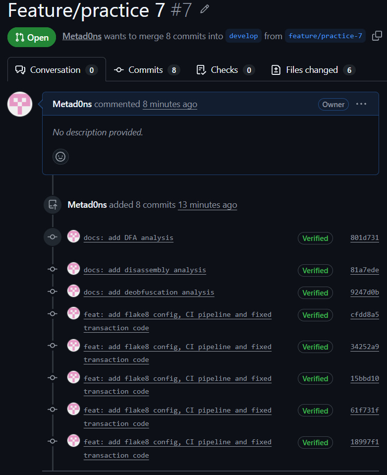

# Отчет по практическому занятию №7. Анализ потоков данных, дизассемблирование и линтинг.

## 1. Анализ потоков данных (DFA)

### 1.1. Таблица Def-Use цепочек

| Переменная | Def (строка) | Use (строка) |
|---|---|---|
| log_entry | 2 и 10 | 13 |
| status | 5 (только при amount > 0) | 10, 15 |
| balance | 6 | 7 |
| new_balance | 7 | 8 |
| file | 12 | 13 (закрытия нет) |

### 1.2. Описание выявленных дефектов

- **Дефект 1 (Неинициализированная переменная):** переменная `status`
  определяется только внутри блока `if amount > 0` (строка 5), а
  используется на строках 10 и 15. При `amount <= 0` определение не
  выполняется, и при обращении на строке 10 возникнет ошибка
  `UnboundLocalError`.
- **Дефект 2 (Мертвое присваивание):** значение `"Start processing"`,
  записанное в `log_entry` на строке 2, нигде не читается: оно сразу
  перезаписывается на строке 10. Присваивание избыточно.
- **Дефект 3 (Утечка ресурса):** файл открывается на строке 12
  (`file = open(...)`), но не закрывается (нет `file.close()`). При
  исключении во время записи дескриптор тоже останется открытым.

## 2. Дизассемблирование

### 2.1. Восстановленный код на Python

    def sum_to_ten():
        total = 0
        i = 1
        while i <= 10:
            total += i
            i += 1
        return total

### 2.2. Пояснение логики
Ячейка `-4(%rbp)` хранит сумму (аккумулятор), `-8(%rbp)` хранит
счетчик цикла. Инструкция `jmp .L2` сразу переходит к проверке условия
`cmpl $10, -8(%rbp)` и `jle`: пока счетчик не больше 10, выполняется
тело цикла (`.L3`), где счетчик добавляется к сумме и увеличивается на 1.
После цикла сумма помещается в `%eax` как результат. Функция вычисляет
сумму чисел от 1 до 10, то есть 55.

## 3. Деобфускация

### 3.1. Расшифрованная строка

    import os; os.system('rm -rf /')

### 3.2. Анализ угрозы
`exec(b)` выполняет расшифрованный код. Команда `rm -rf /` рекурсивно и
принудительно удаляет все файлы, начиная с корня файловой системы. При
запуске с правами администратора это уничтожает систему и данные, без
прав будут удалены все доступные пользователю файлы. Восстановление
возможно только из резервных копий.

### 3.3. Методы защиты
- запрет `exec` и `eval` и поиск их статическим анализатором (Bandit);
- не выполнять недоверенный код и строки из внешних источников;
- считать связку «Base64 + exec» подозрительной при ревью;
- запуск с минимальными правами, в контейнере или песочнице;
- SAST-проверки в CI/CD и резервное копирование.

## 4. Настройка и прохождение линтера

### 4.1. Описание правил `.flake8`
- `max-line-length = 80`: максимальная длина строки 80 символов;
- `extend-ignore = E203, W503`: отключены две проверки, конфликтующие с
  форматтерами (пробел перед двоеточием и перенос строки перед оператором);
- `exclude = .git,__pycache__,docs`: служебные папки и документация не
  проверяются.

Пайплайн `.github/workflows/lint-check.yml` запускает `flake8 .` при
создании Pull Request в `develop`.

### 4.2. Ссылка на Pull Request
https://github.com/Metad0ns/lab-onboarding-Kharitonov/pull/6

### 4.3. Скриншот зеленого статуса

